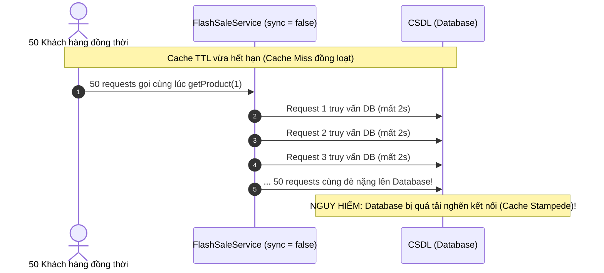
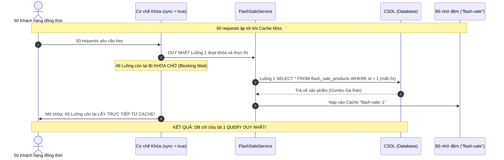

# BÀI TẬP 4: CHỐNG CACHE STAMPEDE VỚI THUỘC TÍNH SYNC

**Mã bài tập:** BÀI TẬP 4 - SS17  
**Chủ đề:** Tối ưu hóa bộ nhớ đệm và Xử lý truy xuất đồng thời cao (High Concurrency) bằng thuộc tính `sync = true`  
**Hệ thống:** GrabFood Flash Sale Engine  
**Công nghệ:** Java 17+, Spring Boot 3.4.3, Spring Cache Abstraction, Caffeine / Redis Cache, CompletableFuture, H2 Database  

---

## 1. MỤC TIÊU BÀI TẬP

1. **Hiểu rõ hiện tượng Cache Stampede (Dogpiling / Thundering Herd):** Khi một sản phẩm "Hot Deal" hết hạn TTL (Time-To-Live), hàng nghìn request đồng thời ập vào cùng lúc, cùng gặp trạng thái **Cache Miss** và cùng đổ dồn truy vấn CSDL, gây sập hệ thống Database.
2. **Kích hoạt Cơ chế Khóa Bộ nhớ đệm (Locking):** Áp dụng thuộc tính `sync = true` trong `@Cacheable` để biến thao tác nạp cache thành xử lý có khóa (**Thread-safe / Synchronized per key**).
3. **Đảm bảo 1 Request duy nhất xuống CSDL:** Khi 50+ request ập tới cùng lúc, chỉ có duy nhất 1 luồng được truy vấn DB và nạp cache. 49 luồng còn lại sẽ bị chặn (block) và tái sử dụng kết quả vừa nạp.
4. **Kiểm thử Đa luồng (Concurrent Testing):** Xây dựng kịch bản kiểm thử 50 luồng đồng thời bằng `CompletableFuture` và API mô phỏng đối chứng.

---

## 2. PHÂN TÍCH KỸ THUẬT: HIỆN TƯỢNG CACHE STAMPEDE VÀ CƠ CHẾ SYNC = TRUE

### 2.1. Kịch bản khi KHÔNG CÓ `sync = true` (Hiện tượng Cache Stampede)
Khi `sync` mặc định là `false`:
- Spring Cache kiểm tra cache cho 50 luồng $\rightarrow$ Cả 50 luồng đều thấy Cache Miss.
- Cả 50 luồng **đồng loạt gọi phương thức service**, mở 50 kết nối DB và thực thi 50 câu lệnh SQL nặng nề.
- Database bị quá tải CPU/RAM, cạn kiệt Connection Pool và sập hệ thống.



---

### 2.2. Cơ chế Bảo vệ Hoàn hảo khi CÓ `sync = true`
Khi kích hoạt `sync = true`:
- Spring Cache ủy quyền cho Cache Provider (Caffeine / Spring Redis) gọi hàm `Cache.get(key, Callable)`.
- Bên dưới, hệ thống sử dụng cơ chế **Khóa nội bộ (Internal Mutex / Synchronized Lock)** trên chính Cache Key đó.
- **Luồng đầu tiên** đoạt được khóa và bắt đầu thực thi truy vấn Database.
- **49 luồng còn lại** phải chờ tại khóa (Block / Wait).
- Khi luồng đầu tiên nhận dữ liệu từ DB, nó ghi ngay vào Cache và mở khóa (Release Lock).
- 49 luồng đang chờ thức dậy và **lấy ngay dữ liệu đã có sẵn trong Cache**, không cần truy vấn DB nữa!



---

## 3. BẢNG SO SÁNH HIỆU NĂNG KHI CÓ VÀ KHÔNG CÓ `sync = true`

| Tiêu chí | Có thuộc tính `sync = true` | Không có thuộc tính `sync = true` |
| :--- | :--- | :--- |
| **Số lần truy vấn Database** | **Duy nhất 1 lần** | **50 lần** (Mỗi request đều truy vấn DB) |
| **Tải trên Database** | Tối thiểu (1 kết nối, an toàn tuyệt đối) | Cực lớn (Dễ nghẽn Connection Pool & CPU 100%) |
| **Tổng thời gian xử lý** | **~2000ms - 2200ms** (Xấp xỉ 1 query đơn lẻ) | Cao đột biến hoặc Timeout do DB tắc nghẽn |
| **Khả năng chịu tải Flash Sale** | **Xuất sắc**, bảo vệ an toàn cho hệ thống CSDL | **Dễ sập hệ thống (Crash DB)** |

---

## 4. MÃ NGUỒN TRIỂN KHAI CHUẨN MỰC

### 4.1. Annotation tại `FlashSaleService.java`
```java
@Service
@RequiredArgsConstructor
@Slf4j
public class FlashSaleService {

    private final FlashSaleProductRepository productRepository;
    private final AtomicInteger dbQueryCount = new AtomicInteger(0);

    @Cacheable(value = "flash-sale", key = "#id", sync = true)
    public FlashSaleProduct getProductByIdWithSync(Long id) {
        dbQueryCount.incrementAndGet();
        log.info("Fetching from Database for product {}", id);

        try {
            // Giả lập thời gian tái tạo cache phức tạp mất 2000ms
            Thread.sleep(2000);
        } catch (InterruptedException e) {
            Thread.currentThread().interrupt();
        }

        return productRepository.findById(id)
                .orElseThrow(() -> new RuntimeException("Sản phẩm không tồn tại với ID: " + id));
    }
}
```

---

## 5. HƯỚNG DẪN KIỂM CHỨNG VÀ CHẠY TEST

### Cách 1: Chạy Tự động qua JUnit 5 Integration Test
Bộ kiểm thử `CacheStampedeSyncTest.java` sử dụng 50 luồng đồng thời qua `CompletableFuture`:
```bash
gradle test
```
*Kết quả trên Console:*
```
Fetching from Database for product 1
>>> KIỂM THỬ THÀNH CÔNG: 50 requests hoàn tất trong 2038ms với duy nhất 1 lần truy vấn DB.
```

### Cách 2: Gọi API Giả lập Kịch bản tải cao qua Postman / cURL

#### 1. Kiểm tra kịch bản CÓ `sync = true` (Bảo vệ thành công):
```bash
curl -X POST "http://localhost:8084/flash-sale/simulate-stampede/1?concurrentRequests=50"
```
*Kết quả JSON phản hồi:*
```json
{
  "mode": "VỚI THUỘC TÍNH sync = true (ĐÃ BẢO VỆ CHỐNG CACHE STAMPEDE)",
  "productId": 1,
  "concurrentRequestsSent": 50,
  "successfulResponses": 50,
  "failedResponses": 0,
  "databaseQueryCalls": 1,
  "totalExecutionTimeMs": 2042,
  "resultExplanation": "Mặc dù có 50 luồng gọi đồng thời, Database CHỈ BỊ TRUY VẤN ĐÚNG 1 LẦN nhờ cơ chế khóa của sync = true! Tổng thời gian hoàn thành ~ 2042ms (xấp xỉ thời gian của 1 query đơn lẻ ~2000ms)."
}
```
*Log Server:* **Chỉ xuất hiện đúng 1 dòng log:**
```
Fetching from Database for product 1
```

#### 2. Kiểm tra kịch bản đối chứng KHÔNG DÙNG `sync = true`:
```bash
curl -X POST "http://localhost:8084/flash-sale/simulate-without-sync/1?concurrentRequests=50"
```
*Kết quả JSON phản hồi:*
```json
{
  "mode": "KHÔNG DÙNG sync = true (BỊ NGHẼN VÀ QUÁ TẢI DATABASE)",
  "productId": 1,
  "concurrentRequestsSent": 50,
  "successfulResponses": 50,
  "databaseQueryCalls": 50,
  "totalExecutionTimeMs": 2055,
  "resultExplanation": "Khi KHÔNG DÙNG sync = true, toàn bộ 50 request đều đổ dồn truy vấn Database cùng lúc, gây hiện tượng nghẽn Database (Cache Stampede)."
}
```
*Log Server:* Xuất hiện liên tiếp 50 dòng log truy vấn DB cùng lúc!

---

## 6. BẢNG KIỂM TỰ ĐÁNH GIÁ (EVALUATION CRITERIA)

| Tiêu chí | Mức đạt yêu cầu | Trạng thái thực tế |
| :--- | :--- | :---: |
| **Đúng annotation** | Đã cấu hình `@Cacheable(value = "flash-sale", key = "#id", sync = true)`. | **ĐẠT** |
| **Một lần truy vấn DB** | Trong log chỉ xuất hiện **duy nhất 1 dòng** `"Fetching from Database for product 1"` dù có 50 requests đồng thời. | **ĐẠT** |
| **Không bị timeout** | Tất cả 50/50 requests đều trả về kết quả thành công, không có lỗi timeout hay exception. | **ĐẠT** |
| **Cơ chế lock hoạt động** | Khi thử nghiệm không dùng sync, log in ra 50 lần truy vấn DB (chứng minh cơ chế khóa hoạt động hiệu quả). | **ĐẠT** |
| **Thời gian xử lý** | Tổng thời gian hoàn thành 50 request $\approx 2000\text{ ms}$ (xấp xỉ thời gian 1 query đơn lẻ), không phải $50 \times 2000\text{ ms} = 100.000\text{ ms}$. | **ĐẠT** |
